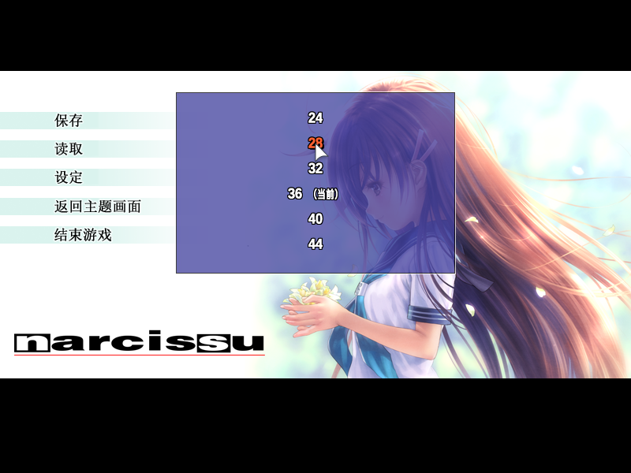
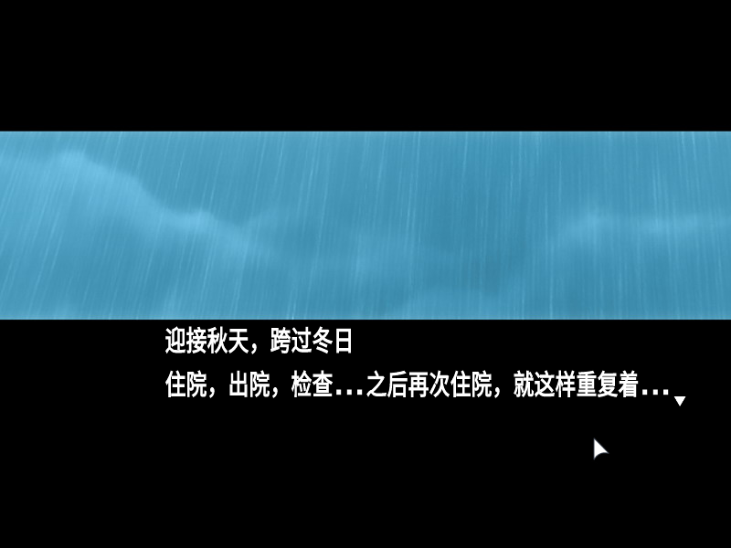

# NarciBloom · 水仙舒读

让《水仙》的文字，在掌心舒展开来。

《Narcissu 10th Anniversary Anthology Project》Steam 中文版的字号与排版改良项目，优先改善 Steam Deck 上的阅读体验。

**当前状态：开发预览。** 已在个人设备上使用，正在逐章实测；目前提供开发源码，还没有面向普通玩家的一键安装包。请勿将中间构建产物直接覆盖到游戏目录。

[English](README.en.md) · [兼容性与测试范围](docs/COMPATIBILITY.md) · [开发与构建](docs/DEVELOPMENT.md) · [后续计划](docs/ROADMAP.md) · [更新记录](CHANGELOG.md)

## 做了什么

- 游戏内选择 **24 / 28 / 32 / 36 / 40 / 44** 六档字号，显示当前档位，默认 36。
- 调整正文、角色名及相关文字的字体参数；图片中绘制好的文字不随之缩放。
- 修正 1＋2 的小文本区：大字号下换行时不再每行都清除前文。
- 修正当前 1＋2 汉化版本的字体窗口标签与按钮错乱，保留中文剧情与字号菜单。

1＋2 的入口：剧情中打开暂停菜单 → **设定 → 字体 / 字号 → 字号：当前值**。

其他篇章的实现是在原设置页底部增加字号选择；实际验证范围请看兼容性说明。

## 适用范围

目前针对 **Steam 十周年合集、当前已测试的简体中文汉化版本**。免费版《Narcissu 1st & 2nd》（另一款 Steam 应用）、其他汉化版本及原日文/英文版本尚未验证，不能直接视为兼容。

已在 Steam Deck、Proton 7.0 下检查 1＋2 的字号菜单，以及一代 44 档、二代 36 档的多行显示。**尚未逐章通关验证；Windows 运行效果尚未验证。**

## 现在如何使用

普通玩家可以先关注本项目，等待可分发的测试安装包。愿意参与开发的用户请阅读[构建说明](docs/DEVELOPMENT.md)：工具只在本地工作目录生成产物，不自动修改游戏。

仓库不包含游戏本体、剧情文本、语音、CG、汉化原文件或玩家存档。构建需要自行准备对应版本的游戏与汉化文件，产物不应作为完整游戏资源上传。

## 反馈

遇到问题请在 Issues 提供：篇章与场景、字号、游戏/汉化版本、设备与 Proton 版本，以及现象截图。请尽量避免剧情剧透，不要公开上传存档或完整游戏文件。

## 许可与致谢

本项目自行编写的代码采用 [MIT](LICENSE) 许可。游戏与汉化内容属于各自权利人，不在本项目许可范围内。

感谢 [majiro-py](https://github.com/trigger-segfault/majiro-py) 和 [evbunpack](https://github.com/mos9527/evbunpack) 提供的基础工具。依赖许可与来源见 [THIRD_PARTY.md](THIRD_PARTY.md)。本项目为非官方阅读体验改良项目，与游戏开发商、发行商及汉化作者无隶属关系。
